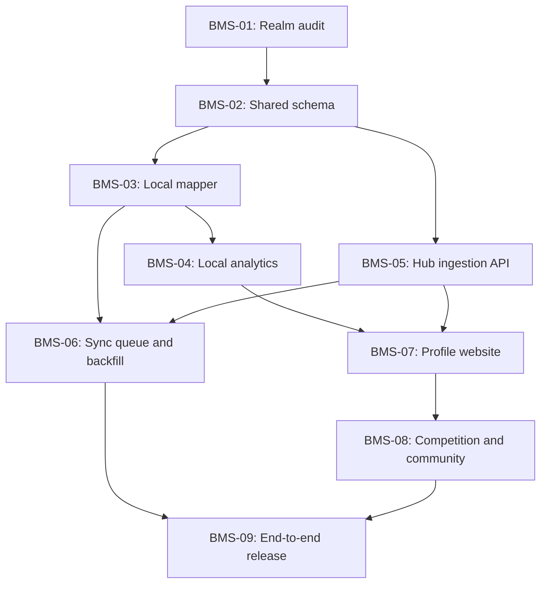

# Roxysu BMS Support — Repository Implementation Specification

**Target:** [Yon-Luc/Roxysu](https://github.com/Yon-Luc/Roxysu)  
**Ruleset:** [QingQiz/BmsRuleset](https://github.com/QingQiz/BmsRuleset)  
**Reference website:** [BokuTachi](https://boku.tachi.ac/)

## 1. Goals and decisions

Implement BMS support throughout Roxysu, from local osu!lazer score import to online profiles and community statistics.

Confirmed decisions:

- **Hub:** extend the existing Hub API and database.
- **Local score reader:** use the existing Realm reader.
- **Historical uploads:** upload all eligible existing local BMS scores when the user enables historical sync.
- **Trust policy:** accept scores as community-submitted local scores, with provenance and basic validation; do not imply server verification.
- **Difficulty tables:** import from the ruleset and maintain a versioned Hub catalogue.
- **Gameplay variants:** separate Scratch, No-Scratch, Constant Score, and other incompatible variants in statistics and leaderboards.
- **Website:** reuse Roxysu's existing design system and similar page layouts.
- **Feed updates:** polling initially.
- **Country:** use the linked osu! account's country.
- **Extra requirements:** none.

> **Repository caveat:** Roxysu's public README documents a local-first architecture. The online Hub repository and its implementation details must be identified before exact Hub file paths can be specified. Paths below are based on the public Roxysu repository where known; proposed files are marked accordingly.

## 2. Architecture

Expected local flow:

```text
osu!lazer + BMS Ruleset
        |
        v
apps/realm-reader (read-only Realm access)
        |
        v
packages/db (local SQLite)
        |
        +--> apps/server local API and analytics
        |
        +--> durable BMS sync queue
                    |
                    v
             Existing Roxysu Hub API
                    |
                    v
             Hub database and aggregates
                    |
                    v
             Public Roxysu website
```

The desktop app must remain usable offline. Local import and analysis must never depend on Hub availability. The public website must read data from the Hub and must not require access to a user's local Realm database.

### Core invariants

1. Keep `client.realm` read-only.
2. Add BMS as a ruleset-specific adapter; do not rewrite other ruleset integrations.
3. Preserve both EX score and normalized score where available.
4. Preserve BMS judgements, clear lamp, gauge, gameplay variant, and other recoverable ruleset metadata.
5. Keep local score ingestion independent from online upload.
6. Upload all eligible historical scores when the user requests historical sync.
7. Use durable, idempotent uploads and per-score batch outcomes.
8. Separate incompatible gameplay variants in statistics and rankings.
9. Version difficulty-table definitions instead of overwriting history.
10. Store unknown values as `null`; do not infer data that cannot be recovered.
11. Treat uploaded scores as community-submitted unless stronger verification is implemented.
12. Reuse existing Roxysu authentication, user identities, database entities, API conventions, and UI components wherever possible.

## 3. Repository areas

| Repository path | Responsibility |
|---|---|
| `apps/realm-reader` | Read Realm score/beatmap records and map them into local storage |
| `apps/server` | Local API, analytics, synchronization orchestration, and UI integration |
| `packages/db` | Shared Drizzle schema and SQLite clients |
| `docs/architecture.md` | Architecture and data-ownership contracts |
| `package.json`, `bun.lock` | Workspace scripts and dependency management |
| Existing Hub repository | Online ingestion, public API, canonical scores, profiles, tables, rankings |

Do not create duplicate score, user, or chart entities until the existing schemas have been inspected.

## 4. Work breakdown and dependencies

### BMS-01 — Audit Realm records and current pipelines

**Location:** `apps/realm-reader`  
**Dependencies:** none

Tasks:

- Trace an existing score from Realm to the local database and UI.
- Identify ruleset detection and how existing game modes are represented.
- Inspect Realm schemas and compatibility/version handling.
- Determine which BMS fields are available: stable score ID, chart ID/hash, achieved time, EX score, normalized score, judgements, gauge, lamp, mods, variant settings, judgement algorithm, and replay reference if any.
- Determine which chart metadata can be extracted from Realm versus the ruleset or chart files.
- Inspect full-sync, incremental import, and reconciliation behavior.
- Capture representative BMS score and chart fixtures from a real installation.
- Document missing or ambiguous fields and the deduplication strategy.

**Deliverable:** a field-mapping document, test fixtures, and a list of schema changes.

**Acceptance criteria:**

- The source and meaning of every mapped field are documented.
- Missing fields are represented as unavailable rather than guessed.
- Realm remains read-only.
- Existing ruleset mappings have regression tests.

### BMS-02 — Extend shared local schema

**Location:** `packages/db`  
**Dependencies:** BMS-01

Tasks:

- Extend the existing generic score/beatmap schema where appropriate.
- Add a typed BMS extension table only where generic fields would become excessively sparse or ambiguous.
- Add the durable upload queue.
- Add a local cache for imported table definitions and versions if not already supported.
- Generate migrations using the repository's existing workflow.
- Preserve current table ownership: Realm reader writes imported data; local server writes analytics and sync state.

Proposed local entities:

| Entity | Purpose |
|---|---|
| Existing `scores` | Generic score data, ruleset identity, source IDs, shared metrics |
| Existing `beatmaps` | Canonical/local chart metadata and hashes |
| Existing `imports` | Incremental import and reconciliation state |
| `bms_score_details` (optional) | BMS-specific metrics and gameplay configuration |
| `bms_sync_queue` | Pending uploads, retries, outcome, and Hub score ID |
| `bms_table_cache` (optional) | Cached table versions for offline analytics |

**Acceptance criteria:**

- Migration preserves existing data.
- Existing rulesets continue to import and render correctly.
- The Realm reader does not write sync-queue or analytics tables.
- Queue state survives application restarts.

### BMS-03 — Implement local BMS mapping and import

**Location:** `apps/realm-reader`  
**Dependencies:** BMS-01, BMS-02

Tasks:

- Add a BMS-specific mapper following existing reader conventions.
- Map source score and chart identifiers.
- Preserve EX score, normalized score, judgement counts, clear lamp, gauge, mods, variant, and other fields confirmed by the audit.
- Resolve chart identity using stable hashes and ruleset identifiers; do not use file path or display name alone.
- Support full and incremental scans.
- Make rescans idempotent.
- Handle deleted/missing chart files and unknown ruleset versions gracefully.
- Avoid assuming BMS fields exist on non-BMS records.

**Acceptance criteria:**

- BMS scores appear in local Roxysu score history.
- Repeated scans do not create duplicates.
- Scores remain available offline.
- Existing rulesets pass regression tests.

### BMS-04 — Add local BMS analytics and API support

**Location:** `apps/server` (existing analytics/API areas)  
**Dependencies:** BMS-03

Tasks:

- Add BMS-aware recent score and score history queries.
- Add per-variant best score and play-count queries.
- Add session aggregation using existing conventions.
- Add BMS profile summary and table-completion calculations.
- Keep mode/variant filters explicit.
- Avoid applying osu!standard or osu!mania scoring assumptions to BMS.
- Expose local endpoints through the existing router and response conventions.

**Acceptance criteria:**

- Recent scores, history, best scores, play counts, and sessions are correct.
- Scratch and No-Scratch statistics are separate.
- Queries are paginated and avoid loading entire histories into memory.
- Local views work without a Hub connection.

### BMS-05 — Extend existing Hub API and database

**Location:** existing Hub repository; exact path to confirm  
**Dependencies:** BMS-02 and agreement on the canonical score contract

Tasks:

- Reuse the existing Hub user and authentication models.
- Link BMS submissions to the authenticated Roxysu user and linked osu! account.
- Add canonical chart/score persistence, or extend existing entities.
- Add batch score ingestion with per-item results.
- Add atomic uniqueness constraints and idempotency.
- Store submission provenance and validation status.
- Add public profile, score-history, chart, table, feed, comparison, and statistics query support in stages.
- Use osu! account country as the source of country information.
- Keep public visibility and private-profile enforcement on the server.
- Validate payload sizes, allowed IDs, numeric ranges, ownership, and timestamps.
- Do not claim a locally submitted score is server-verified.

**Acceptance criteria:**

- Authenticated users can submit batches.
- A retry does not create duplicate scores.
- The Hub ignores client-supplied user identity in favor of the authenticated principal.
- Private profiles do not leak through public endpoints.
- Existing Hub APIs remain backward-compatible.

### BMS-06 — Durable sync queue and historical backfill

**Location:** local `apps/server` + `packages/db`; online side uses BMS-05  
**Dependencies:** BMS-03, BMS-05

Tasks:

- Add preferences for automatic upload, historical upload, and retry behavior.
- When historical sync is enabled, enumerate all eligible existing local BMS scores.
- Persist jobs in bounded batches; do not load the whole history into memory.
- Store a durable cursor/high-water mark and resume after restart.
- Queue newly imported scores when automatic upload is enabled.
- Upload bounded batches and process each score result independently.
- Retry transient failures with exponential backoff and jitter.
- Mark permanent validation failures and expose actionable reasons.
- Keep local import independent from network availability.
- Add manual retry and sync status.
- Avoid re-uploading scores already accepted by the Hub.

Suggested queue states:

```text
pending -> uploading -> synced
                    -> retry_wait -> uploading
                    -> rejected
```

**Acceptance criteria:**

- Backfill includes all eligible historical scores.
- Restart during backfill does not skip or duplicate scores.
- Partial batch failures do not block successful items.
- Disabling sync prevents new uploads but does not delete local scores.
- Offline mode continues to import and analyze scores.

### BMS-07 — BMS profile and website pages

**Location:** existing frontend within Roxysu; exact route structure to confirm  
**Dependencies:** BMS-04 and BMS-05

Reuse the current design system, component conventions, routing, query cache, and charting library. Shared presentation components may be reused between local and public views, but public pages must use Hub data.

Proposed routes:

| Page | Proposed route | Release |
|---|---|---|
| Player profile | `/bms/players/:username` | MVP |
| Score history | `/bms/players/:username/scores` | MVP |
| Table completion | `/bms/players/:username/tables` | MVP |
| Chart page | `/bms/charts/:chartId` | Next |
| Chart leaderboard | `/bms/charts/:chartId/leaderboard` | Next |
| Profile comparison | `/bms/compare/:playerA/:playerB` | Next |
| Score feed | `/bms/feed` | Next |
| Global statistics | `/bms/statistics` | Later |

Profile MVP:

- Player identity and osu!-derived country.
- Recent scores and paginated history.
- Total plays and activity.
- Separate statistics by gameplay variant.
- Difficulty-table completion by version and achievement.
- Session summaries.
- Public/private profile behavior and shareable URLs.

**Acceptance criteria:**

- A public profile renders entirely from Hub data.
- Score history supports pagination and filters.
- Variant selection is explicit and consistent across views.
- Private profile data is not exposed to anonymous users.
- UI matches the existing Roxysu design system.

### BMS-08 — Leaderboards, comparison, feed, and global analytics

**Location:** existing Hub API and website  
**Dependencies:** BMS-05, BMS-07

Tasks:

- Add chart-specific leaderboards.
- Filter by achievement, gameplay variant, gauge, and country.
- Add player profile comparison: scores, rankings, stats, and table completion.
- Add a public feed of eligible score submissions.
- Start with cursor-based polling; do not implement realtime infrastructure initially.
- Add global totals, unique accepted scores, submission counts, active players, and timeseries.
- Distinguish unique scores from HTTP submission attempts and retries.
- Add aggregates only where query volume requires them; define how they are rebuilt/reconciled.

**Acceptance criteria:**

- Incompatible variants never share a leaderboard accidentally.
- Filters are reflected in query parameters and shareable URLs.
- Duplicate retries do not inflate global play counts.
- Feed polling does not duplicate or skip items.
- Global statistics have documented definitions.

### BMS-09 — End-to-end verification and release

**Dependencies:** BMS-03 through BMS-08

Test:

- Realm fixture mapping and ruleset regression.
- Database migration and data preservation.
- Duplicate scans and duplicate upload retries.
- Backfill interruption/resume.
- Partial batch failure.
- Variant separation.
- Table-version updates and unresolved entries.
- Authentication and user ownership.
- Private-profile access.
- Feed pagination and polling.
- Large history performance.

## 5. Dependency graph



**Critical path:** Realm audit → score contract/schema → local import → Hub ingestion → historical sync → public profile.

## 6. Proposed canonical data model

These are logical proposals. Reuse existing tables where possible rather than duplicating users, scores, or charts.

### Local database

- `scores`: generic score fields and ruleset/source identifiers.
- `beatmaps`: local chart metadata and stable hashes.
- `imports`: incremental import/reconciliation state.
- `bms_score_details` (optional): BMS-only metrics and gameplay fields.
- `bms_sync_queue`: source score identity, installation ID, state, retry metadata, payload version, Hub score ID, and last error.
- `bms_table_cache` (optional): imported table snapshots for local/offline calculations.

### Hub database

| Entity | Important fields |
|---|---|
| Existing `users` | Hub user ID, linked osu! ID, country, privacy |
| `installations` | Installation ID, owner, client version, last sync |
| `bms_charts` | Canonical chart ID, source identifiers, hashes, title, artist, key layout |
| `bms_scores` | User, chart, score metrics, judgements, achieved time, variant, gauge, provenance |
| `bms_score_submissions` | Installation ID, source score ID, payload hash, received time, validation status |
| `bms_tables` | Table identity and source metadata |
| `bms_table_versions` | Immutable version/snapshot identity and import time |
| `bms_table_entries` | Version, chart mapping, level, position, source metadata |
| `bms_daily_stats` (optional) | Derived daily aggregates for global activity |

### Canonical score transport type

Illustrative TypeScript contract; the exact mapping must follow BMS-01's findings.

```typescript
type BmsScore = {
  id: string;
  userId: string;
  chartId: string;

  source: {
    rulesetId: string;
    localScoreId: string;
    installationId: string;
  };

  achievedAt: string;

  score: {
    exScore: number | null;
    normalizedScore: number | null;
    maxExScore: number | null;
    accuracy: number | null;
  };

  judgements: {
    pgreat: number | null;
    great: number | null;
    good: number | null;
    bad: number | null;
    poor: number | null;
    ePoor: number | null;
  };

  gameplay: {
    variantId: string;
    gaugeId: string | null;
    clearLampId: string | null;
    mods: unknown;
    judgementAlgorithm: string | null;
  };

  provenance: {
    origin: "local_realm";
    receivedAt: string;
    trust: "community_submitted";
  };
};
```

Use `null` for unavailable data. Preserve the raw ruleset payload in a versioned form if needed for forward compatibility, with size limits and no sensitive local paths.

### Identity and deduplication

Preferred source uniqueness key:

```text
(user_id, installation_id, ruleset_id, local_score_id)
```

This assumes the source score ID is stable. If it is not available, define and document a deterministic fallback based on actual source fields; do not rely solely on payload hashes because two distinct plays can have identical results.

Chart matching should use reliable content hashes and source identifiers. File paths and display names alone are insufficient.

## 7. Gameplay variants and score semantics

### Variant separation

Create a canonical, versioned mapping from actual ruleset settings to variant IDs. Example IDs:

- `scratch`
- `no_scratch`
- `constant_score`

These are illustrative until the ruleset's actual configuration is audited.

The variant should include every gameplay option that affects competitive comparability. Keep gauge as a separate leaderboard filter unless the ruleset's behavior requires additional score partitioning.

### Achievement semantics

Treat achievement filters as predicates over a score, not as separate score records:

- **Grade:** AA, AAA, MAX.
- **Combo:** FC.
- **Clear:** HARD, EASY, and other supported lamps.

Thresholds and clear conditions must come from the ruleset implementation. One score can qualify for multiple achievements.

### Difficulty-table versioning

1. Import supported table definitions from the ruleset or an approved source.
2. Validate and parse entries.
3. Preserve source URL and original identifiers.
4. Resolve chart hashes and metadata.
5. Store a new immutable table version.
6. Recalculate affected completion summaries.
7. Report unresolved/ambiguous chart mappings.

Completion should be reproducible for a specified player, table version, achievement, and gameplay variant.

## 8. Proposed Hub API contracts

Endpoint names below are proposals. Align them with the existing Hub routing and versioning conventions.

### Authentication and preferences

| Method and path | Purpose |
|---|---|
| `GET /api/me` | Current Hub user and linked osu! identity |
| `GET /api/me/bms/sync` | Sync preferences and current status |
| `PATCH /api/me/bms/preferences` | Update BMS upload and visibility preferences |

Reuse existing OAuth login/session/token handling. Resolve the owner from the authenticated principal, not a payload `userId`. OAuth establishes account identity, not score legitimacy.

### Batch score ingestion

`POST /api/bms/scores/batch`

Example request:

```json
{
  "installationId": "install-uuid",
  "scores": [
    {
      "localScoreId": "source-score-id",
      "rulesetId": "bms",
      "chart": {
        "sourceChartId": "chart-id",
        "hashes": {
          "md5": "optional",
          "sha256": "optional"
        }
      },
      "achievedAt": "2026-10-15T18:30:00Z",
      "score": {
        "exScore": 1234,
        "normalizedScore": 987654
      },
      "gameplay": {
        "variantId": "scratch",
        "gaugeId": "hard",
        "clearLampId": "hard-clear"
      }
    }
  ]
}
```

Example response:

```json
{
  "results": [
    {
      "localScoreId": "source-score-id",
      "status": "accepted",
      "scoreId": "hub-score-id"
    }
  ],
  "nextCursor": null
}
```

The payload is illustrative and must be adjusted to the real BMS fields. Validate batch size, payload size, field ranges, chart references, supported variants, timestamps, and authenticated ownership. Use atomic uniqueness constraints.

Per-score statuses:

- `accepted`: stored; mark synced.
- `duplicate`: already stored; mark synced and retain canonical ID.
- `rejected`: permanent validation failure; show reason and stop automatic retry.
- `retryable_error`: temporary failure; retry with backoff.

An HTTP success does not mean every score succeeded. Process each result independently.

### Public profiles and score history

| Method and path | Parameters/purpose |
|---|---|
| `GET /api/bms/profiles/:username` | Profile overview |
| `GET /api/bms/profiles/:username/scores` | Cursor, limit, variant, sort |
| `GET /api/bms/profiles/:username/stats` | Variant and period |
| `GET /api/bms/profiles/:username/tables` | Table ID and version |
| `GET /api/bms/profiles/:username/sessions` | Cursor, date range |
| `GET /api/bms/profiles/:username/activity` | Activity calendar/timeseries |

Use stable public slugs in URLs and internal IDs in database relationships. Enforce privacy in the API, not only in the UI.

### Charts, tables, leaderboards

| Method and path | Purpose |
|---|---|
| `GET /api/bms/charts/:chartId` | Chart metadata |
| `GET /api/bms/charts/:chartId/leaderboard` | Filtered ranking |
| `GET /api/bms/charts/:chartId/scores/:scoreId` | Score details |
| `GET /api/bms/tables` | Table catalogue |
| `GET /api/bms/tables/:tableId/versions` | Table version history |
| `POST /api/bms/tables/import` | Import/refresh an approved table source |

Leaderboard filters: `variant`, `achievement`, `gauge`, `country`, `cursor`, `limit`. Use a clear default only when unambiguous; otherwise require a variant selection. Reflect filters in query parameters for shareable URLs.

For remote table imports, validate URLs and formats, set timeouts and payload limits, and prevent server-side request forgery.

### Feed and global statistics

| Method and path | Purpose |
|---|---|
| `GET /api/bms/feed?cursor=...&limit=...` | Recent public score submissions |
| `GET /api/bms/stats` | Global totals and aggregates |
| `GET /api/bms/stats/timeseries?from=...&to=...&interval=day` | Historical activity |

Start with cursor-based polling. Define separate metrics for unique accepted scores, submission requests, active players, and plays per period. Retries must not inflate gameplay counts.

## 9. Durable synchronization

### State machine

```text
pending -> uploading -> synced
                    -> retry_wait -> uploading
                    -> rejected
```

### Historical backfill procedure

1. Create a durable backfill job and snapshot boundary/high-water mark.
2. Enumerate every eligible BMS score in stable pages.
3. Upsert queue jobs using the source uniqueness key.
4. Upload bounded batches.
5. Continue to process newly imported scores without gaps.
6. Persist progress and resume after restart.
7. Report pending, accepted, duplicate, rejected, and retrying counts.
8. Avoid loading the full history into memory or holding a long transaction during network requests.

### Sync acceptance tests

- Restart during backfill resumes without skipping or duplicating scores.
- A timeout followed by retry does not create a duplicate.
- One invalid item does not block the rest of the batch.
- Repeated local scans do not reset synced jobs.
- Offline mode still imports and analyzes scores.
- Disabling sync prevents new uploads without deleting local records.
- Visibility changes affect public access without destroying score history.

## 10. Website specification

Reuse Roxysu's existing design system, routing, query caching, and charting conventions.

### Profile MVP

1. Overview: player identity, osu!-derived country, total plays, latest activity, selected variant.
2. Recent scores: chart, EX score, lamp, gauge, timestamp.
3. Score history: pagination, filters, sorting.
4. Table completion: level/achievement breakdown, table version, variant.
5. Sessions and activity: session summaries and historical activity.

### Later pages

- Chart detail and filtered leaderboard.
- Player profile comparison across scores, rankings, stats, and table completion.
- Recent score feed.
- Global play/submission timeseries and country statistics.

Public pages must use Hub data. Local pages must use local APIs. Shared presentation components are encouraged, but do not make the public site depend on a local Realm database.

## 11. Testing and release criteria

### Realm mapping

- BMS records are recognized without changing existing ruleset mappings.
- All available score metrics and gameplay settings are preserved.
- Missing fields are safe and explicit.
- Full and incremental imports are idempotent.
- Realm remains read-only.

### Database and analytics

- Migrations preserve existing data.
- Scores resolve to the correct chart/player.
- Variant-specific best scores, sessions, and completion are correct.
- Table versions yield reproducible results.
- Large histories are paginated and bounded in memory.

### Hub and synchronization

- Authenticated batches are accepted and invalid items rejected.
- Retries are idempotent.
- Backfill resumes after interruption.
- Payloads cannot spoof another user.
- Private profiles do not leak through public endpoints.
- Existing APIs remain compatible.

### Website

- Profiles show correct identity and score history.
- Filters and pagination are consistent.
- Leaderboards use compatible score metrics and variants.
- Polling does not duplicate or skip feed items.
- Local pages work without Hub connectivity.

## 12. First-release definition of done

A player can:

1. Play a chart using the BMS ruleset in osu!lazer.
2. Have Roxysu import the score through Realm.
3. See the score in the local BMS profile.
4. Enable sync and upload all eligible historical BMS scores.
5. Have future scores upload automatically.
6. Open a public Roxysu profile and see the uploaded history.
7. Verify that Scratch and No-Scratch statistics are separate.
8. Retry failed uploads without creating duplicates.

Do not block the first release on global feed, country rankings, or advanced comparisons.

## 13. Recommended implementation order

1. **Audit:** inspect `docs/architecture.md`, Drizzle score/beatmap schemas, Realm mapping, reconciliation, local API, and the actual Hub repository.
2. **Fixture:** capture representative BMS records and write mapping tests.
3. **Local import:** implement the mapper, migration, and local score views.
4. **Contract:** agree on chart identity, score identity, variant/gauge IDs, achievement semantics, provenance, and idempotency.
5. **Hub ingestion:** implement authenticated batch submissions and validation.
6. **Backfill:** implement durable historical upload and ongoing sync.
7. **Profile MVP:** ship public profile, score history, and table completion.
8. **Competition/community:** add chart leaderboards, comparisons, polling feed, country rankings, and global statistics.

## 14. Remaining repository-specific prerequisite

The public Roxysu repository documents the local architecture, but the online Hub implementation and exact route/schema locations have not been confirmed here. Identify the Hub repository (or provide the relevant code if private) before assigning exact filenames, handlers, migrations, and function-level tasks. This avoids duplicating existing Hub functionality and lets the proposed contracts be adapted to the real codebase.
